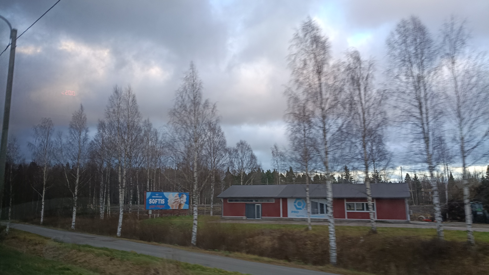
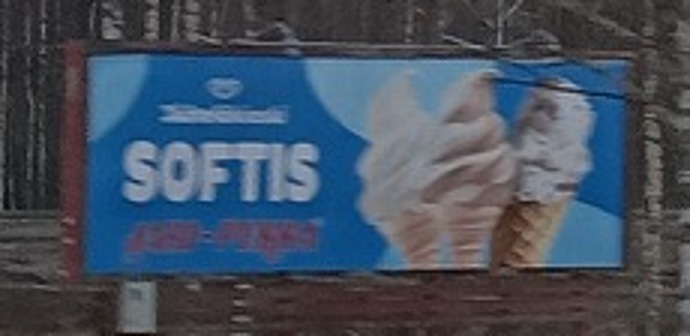
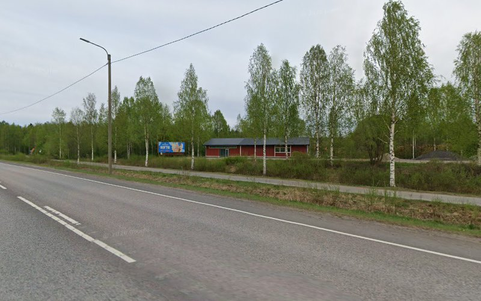
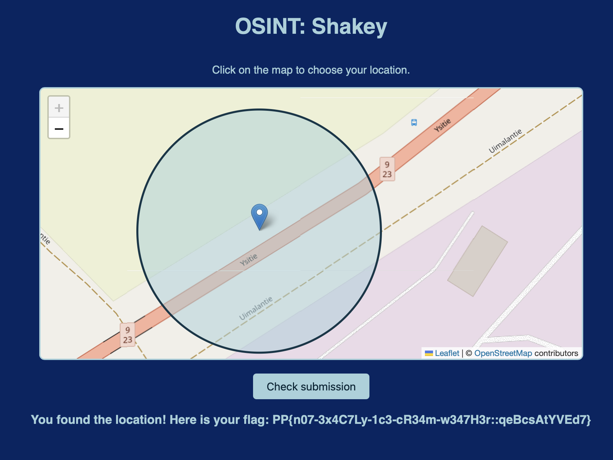

# Platypwn 2026/OSINT-Shakey

A writeup for **Shakey**, an OSINT challenge we played with THEM?!

## Challenge

Someone took this photo from a moving vehicle just before their exit. We had to mark where the camera was on a map. The pin had to land within 10 metres.



## Step 1: Read the signs

I recognized the blue logo on the shed as **ProDoor**, a Finnish door company based in Laukaa. The logo gave us a country to start with. A company can advertise in lots of towns, though, so we looked at the other sign.

Under **SOFTIS**, the small red letters looked like **Jari-Pekka**. That company has service stations in three Finnish towns: Hankasalmi, Hartola and Joroinen.



## Step 2: Find the shed

Just above the ice cream sign, we spotted poles that looked like they held wires over a railway. We checked Hankasalmi first because Highway 9 runs beside the tracks near the station. On the map, a long shed sat between the road and the tracks.

We opened Google Street View. There was the same blue sign, in the same spot to the left of the red shed. Even the narrow window above the door matched.



*Google Street View, Hankasalmi, Finland.*

## Step 3: Place the pin

Look at the wide window on the right side of the shed. In the original photo, a white birch trunk covers the right edge of that window. Move a few metres along the road in Street View and the tree seems to slide across the window.

We compared that tree, the edge of the sign and the ends of the roof from five spots on the road. They lined up best in the lane closest to the shed. Our estimate was **`62.30457, 26.47741`** on **Ysitie (Highway 9), Hankasalmi, Finland**.

## Flag

The map accepted our pin and gave us this flag.

```text
PP{n07-3x4C7Ly-1c3-cR34m-w347H3r::qeBcsAtYVEd7}
```


