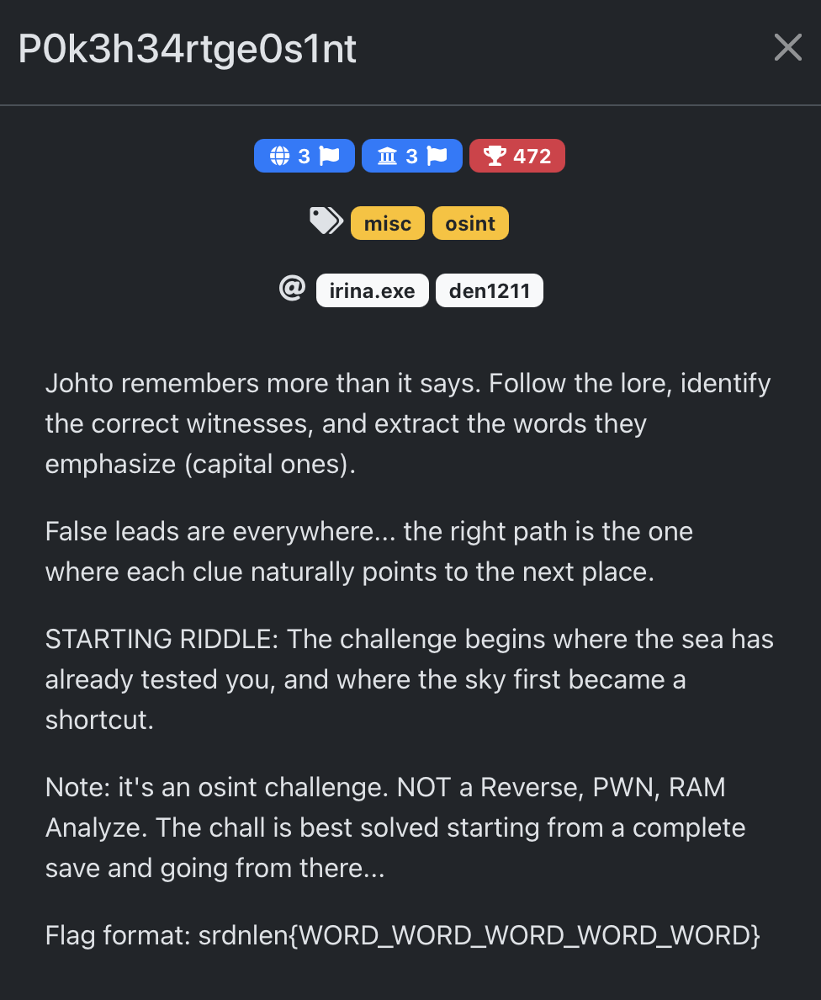
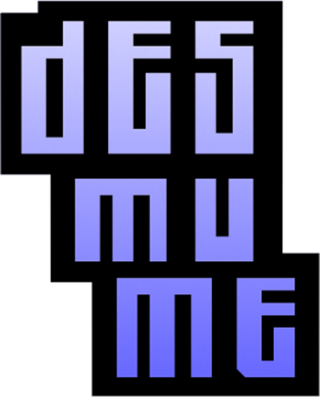
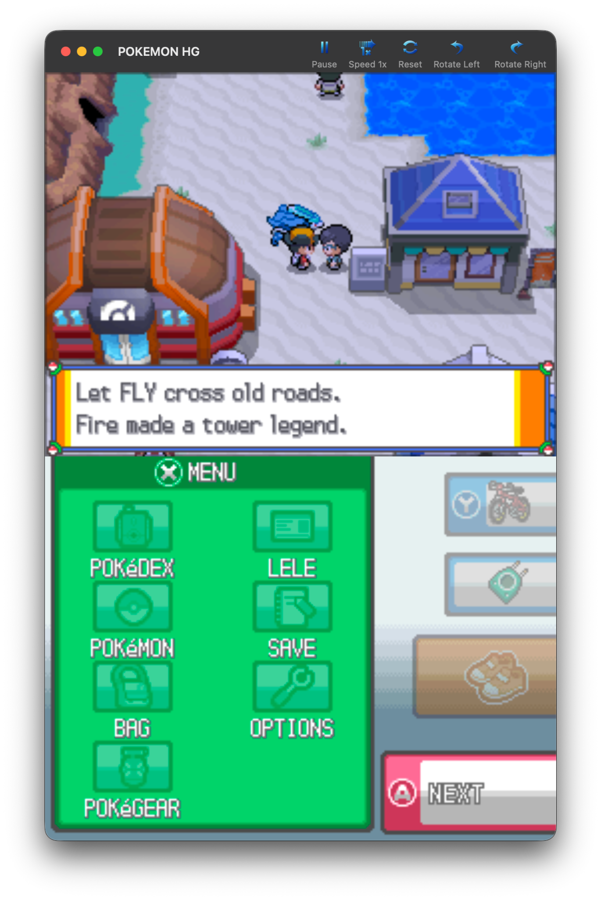
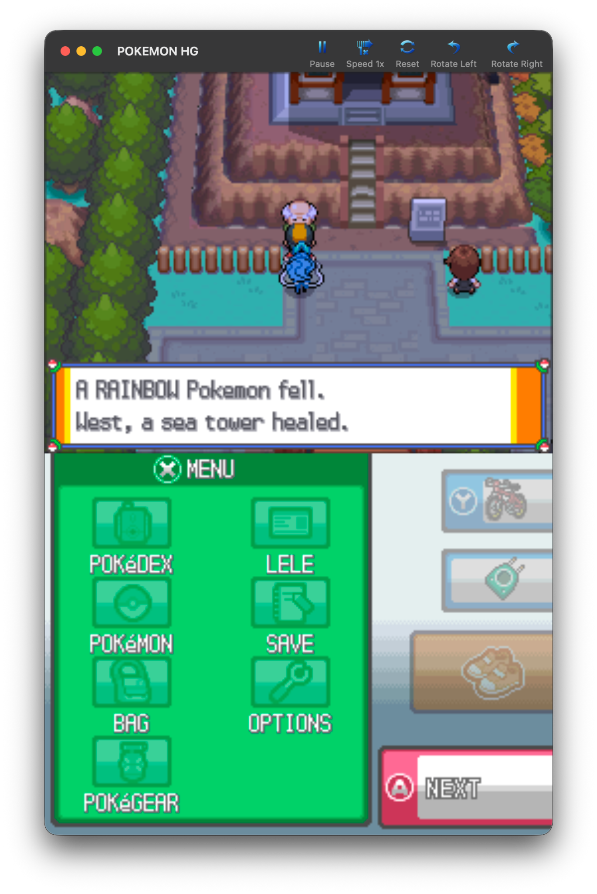
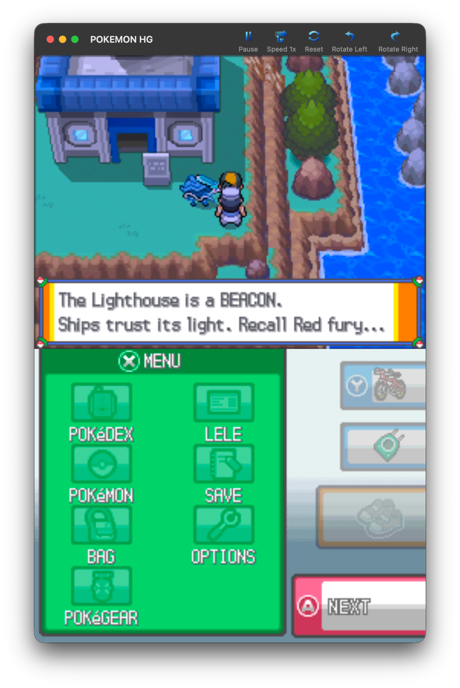
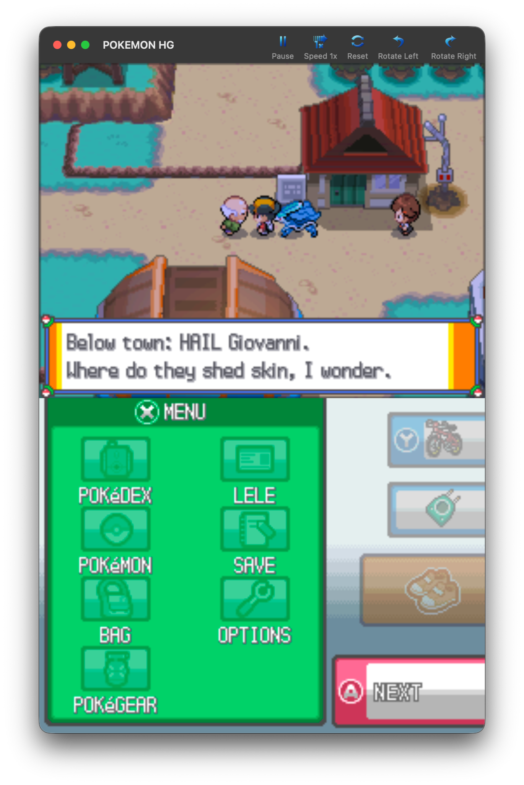
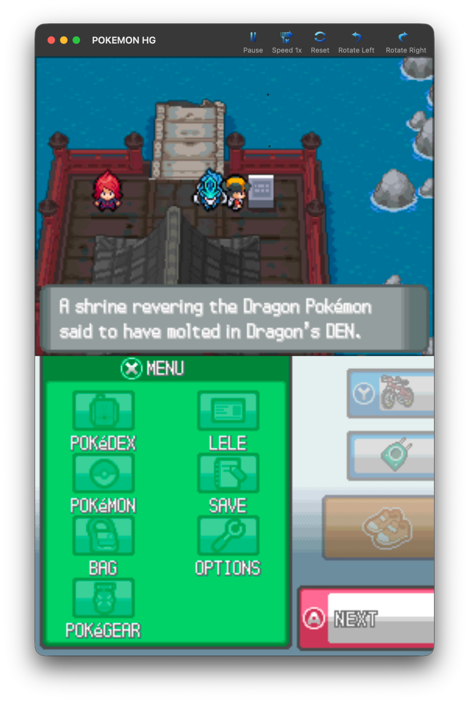

# Srdnlen CTF Finals 2026/OSINT-P0k3h34rtge0s1nt

A writeup for **P0k3h34rtge0s1nt**, a Pokémon challenge I played with **THEM?!** in Sardinia.

**Category:** Misc / OSINT  
**Authors:** irina.exe and den1211  
**Flag format:** `srdnlen{word_word_word_word_word}`

## Challenge

I'd never played *Pokémon HeartGold* before. Luckily, [`Agent Perry`](mailto:agentperry@scr1ptk1dd13s.xyz) from [`$cr1pt_K1dd13$`](
https://scr1ptk1dd13s.xyz/) was playing with **THEM?!**. He knew the game, explained things to me as we went, and found some of the clues too.

The authors had changed some of the text in the game. We had to find five words in capitals, and there were plenty of wrong ones. Our best hint was that each person would say something pointing us to the next place.



I opened the challenge file in **DeSmuME**, a Nintendo DS emulator. We found a completed save online, so we could fly straight to the towns we wanted to check. I also kept this map open. It was super helpful whenever I had a town name and no idea where it was. [BrittleBear's map of HeartGold and SoulSilver](https://www.deviantart.com/brittlebear/art/Pokemon-SoulSilver-HeartGold-Map-719682612)



---

## Step 1: Finding the starting city

> The challenge begins where the sea has already tested you, and where the sky first became a shortcut.

This was where I needed Perry. In the story, you cross the sea from **Olivine** to **Cianwood**. After you beat the Gym there, the Gym Leader's wife gives you **Fly**, so you can fly back across the same stretch of water you just had to cross. Both parts fit Cianwood. I picked **Cianwood City** on the Fly map and headed for the Gym.

### 1. Cianwood City | FLY

From the Gym, I walked up and right onto the sand. There's a blue-roofed photo studio with a camera outside. The **boy between the Gym and the studio** said, “Let FLY cross old roads. Fire made a tower legend.”



We'd found **MEDICINE** in town too, which sounded good because Cianwood has a pharmacy. What sold me on **FLY** was the line *after* it. “Fire made a tower legend” gave us an actual place to check. **Ecruteak City** has a building called the **Burned Tower**.

---

## Step 2: Following the witnesses

### 2. Ecruteak City | RAINBOW

I flew to **Ecruteak** and went to the **top-left corner of town**. The guy we needed was right next to the Burned Tower. At the bottom of the steps, there's a sign on the right and an **old man on the left**. I talked to him.

> A RAINBOW Pokemon fell.  
> West, a sea tower healed.



That gave us **RAINBOW**. For the next stop, “sea tower” sounded like a lighthouse. Looking west on the map put us back on the coast at **Olivine City**. The “healed” part fit too. In the story, you bring medicine to the sick Pokémon that lights the lighthouse.

### 3. Olivine City | BEACON

In **Olivine**, I headed right toward the sea. The witness was right next to the lighthouse again. From its front door, look a few steps **down and right**. There's a **sailor in a white cap** standing on the grass by the cliff.

> The Lighthouse is a BEACON.  
> Ships trust its light. Recall Red fury...



**GLITTER** had seemed possible because the place is called the Glitter Lighthouse. But the sailor gave us **BEACON** *and* “Red fury.” That last bit made sense once I knew about the **red Gyarados at the Lake of Rage**. The lake is just north of **Mahogany Town**, and following that Pokémon's story takes you to Team Rocket's hideout under the souvenir shop there. So we flew to Mahogany and looked around the shop.

### 4. Mahogany Town | HAIL

The souvenir shop is easy to spot. It has a **red roof and an antenna**. I found the **old man in green** a few steps left of its front door, on the road above the Gym.

> Below town: HAIL Giovanni.  
> Where do they shed skin, I wonder.



We had **WINTER** as a possible word here too. “HAIL Giovanni” made more sense standing right above Team Rocket's hideout, since Giovanni is their boss. So we kept **HAIL**. The bit about shedding skin pointed us to **Dratini**, a dragon Pokémon that sheds its skin as it grows. One place you can find it is **Dragon's Den**, behind the Gym in **Blackthorn City**.

---

## Step 3: Finding the last word

### 5. Blackthorn City, Dragon's Den | DEN

I flew to **Blackthorn**, went to the Gym at the top of town, and used **Surf** to cross the water behind it. On the other side there's a cave. I went in and took the ladder down. From the water's edge, I surfed **south toward the island in the middle**. There's a short stone landing on the side facing you.

By this point I'd talked to everyone I could find. All four clues so far had come from people, so I kept looking for someone else to talk to. We'd come up with so many possible words and I'd tried almost every combination I could think of. I got desperate and started reading signs.

Just **right of the stone landing**, outside the shrine, I read this one.



> A shrine revering the Dragon Pokémon  
> said to have molted in Dragon’s DEN.

I was super shocked. I'd been walking around talking to everyone and the last word was on a sign. Reading it a second time, “molted” was what made it click. The man in Mahogany had literally asked *where they shed skin*, and this sign answered him. **DEN**.

## Flag

The format I had was `srdnlen{word_word_word_word_word}`, so I tried `srdnlen{fly_rainbow_beacon_hail_den}` first. It didn't work. After all the combinations we'd tried, these five still made the most sense in that order. I tried the same words again, this time in caps like they were in the game, and it worked.

```text
srdnlen{FLY_RAINBOW_BEACON_HAIL_DEN}
```

## Notes

Shoutout to **irina.exe** and **den1211** for the challenge, and to **Agent Perry** for helping me find my way around Johto on my first time playing. Thanks to the **srdnlen orga** for putting it all together. I had a super nice time in Sardinia. [Sardinia Cyber Camp](https://cybercamp.srdnlen.it)

